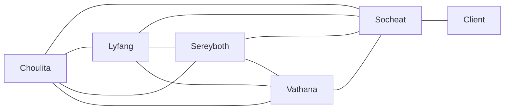

# Communication overhead · longblackcoffee (v1.0, 2026-10-22)

## Paths
| Model | People n | Paths n(n-1)/2 | Minutes/week | Hours/week |
|-------|----------|----------------|--------------|------------|
| (a) everyone + client |6|15|150|2.5|
| (b) client via PO     |5|11|110|1.83|

Assumption: 10 minutes per path per week, because each pair syncs on code, issues and reviews for roughly that long.
Team capacity: 5 members × 6 h = 30 h/week -> overhead = (a) roughly 8.33% (b) roughly 6.1% (6 hours because each lab sessions is 2 hours long, plus 4 hours of work outside class)

## Our paths (model b)

## Two practices
1. GitHub Issues as our single source of truth: We will record every task, question and status update in a GitHub Issue instead of in private chats. Anyone can then find the answer themselves, so fewer questions need to be asked and answered one-on-one. We estimate that this lowers the cost of each path from 10 to 6 minutes per week. New overhead: 11 × 6 = 66 minutes, or 1.1 h/week.
2. Two sub-groups with module owners: We will split the team into a group of three and a group of two, each responsible for its own modules. Members will mainly talk within their own group, and only the two group leads will coordinate across groups. This leaves 3 + 1 paths inside the groups, 1 path between the leads and 1 path between the Product Owner and the client, which makes 6 in total. At 10 minutes per path, the new overhead is 60 minutes, or 1 h/week.

## A sixth member in week 11?
With six members, model (b) gives 16 paths, an increase of about 45% over the current 11. We would decline the offer because a new member would need onboarding just as Sprint 2 begins, and they would add five paths while contributing only one more pair of hands. This is a direct example of Brooks's law.

## Reflection: the essential difficulty we expect first
The essential difficulty we expect to hit first is invisibility. Since software has no physical shape, nobody can see whether the whole team understands ITC Club Hub in the same way. The brief makes this likely with its business rules, such as "capacity cannot be exceeded" and "cancellation closes 24 hours before the start". Each rule is easy to state, but two developers can implement it in two different places or read it differently. One may treat capacity as seats and another as registrations, and nothing looks wrong until the rules disagree.

To prevent this over the next four weeks, we will list every business rule in the README in one plain sentence and keep each rule in exactly one function, with a named owner and a unit test once tests exist. Our early warning sign is the same rule appearing in two files, and reviewers will ask for it to be reused.

- (Leng Choulita, signed) : I will ask in the GitHub Issue before changing a rule that someone else owns, instead of fixing it quietly myself.
- (Sron Lyfang, signed)  :  I will tell the team in the GitHub Issue as soon as I notice the same rule written in two places, instead of waiting for the review.
- (Bou Socheat, signed) : I will keep in check on the GitHub, while also maintaining proper curriculum.
