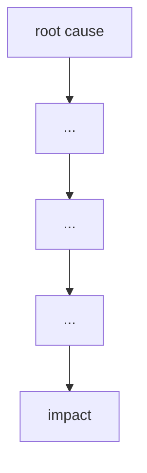

# Failure case analysis · <Mars Climate Orbiter> (v1.0, 2026-10-20)
Authors: Bou Socheat, Leng Choulita, Be Sovanntheavathana, Sron Lyfang, Sarim Sereyboth

## 1. Context

In December, 11, 1998. Nasa launch a robotic space probe "Mars Climate Orbiter" in partnership with Lockheed Martin Astronautics 
to study Mars' climate, atmosphere, and surface changes and to act as a communication relay equipments that was already on mars.
The software that control the thruster output had calculation errors causing the probe to descend too close the the planet and destroyed 
by its atmosphere.
This engineering disaster cost the organization $327.6 billion dollars in losses and it raised global awareness about the critical need
for strict unit standardization, rigorous software validation, and cross-organizational communication in complex engineering projects.

## 2. Timeline
| Date | Event |
|------|-------|

## 3. What failed
<one paragraph>

## 4. Root causes
| # | Root cause | Type | Essential difficulty | Why |
|---|------------|------|----------------------|-----|
| R1 |           | technical / process / organisational | | |

## 5. Practices that would have prevented or limited it
| Root cause | Practice | Chapter |
|------------|----------|---------|

## 6. Lessons for ITC Club Hub
1.
2.

## 7. Sources
1. <author or organisation, title, year, URL> (primary)
