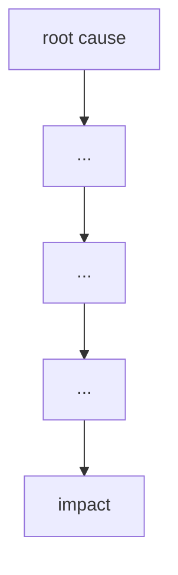

# Failure case analysis · <case> (v1.0, 2026-__-__)
Authors: <member per section>

## 1. Context
## 2. Timeline
| Date | Event |
|------|-------|

## 3. What failed
<one paragraph>

## 4. Root causes
| # | Root cause | Type | Essential difficulty | Why |
|---|------------|------|----------------------|-----|
| R1 |           | technical / process / organisational | | |

## 5. Practices that would have prevented or limited it
| Root cause | Practice | Chapter |
|------------|----------|---------|

## 6. Lessons for ITC Club Hub
 1. Explicit Input and API Contract Validation (Preventing Unit Mismatches) Just as the Mars Climate Orbiter failed because ground software implicitly assumed metric units without validation, our ITC 
Club Hub system must strictly enforce data validation boundaries at all integration checkpoints. Specifically, our CSV import and API payload parsers must explicitly reject any capacity values that are 
not whole numbers between 1 and 500, rather than relying on underlying database schemas or assumption-based type casting. Every external data source, user input, or system migration file must pass 
through an automated validator class that verifies both structural formats and application-specific constraints before it touches the core data layer.
 2. Comprehensive End-to-End Test Coverage for Third-Party or Legacy Code (Preventing Software Silos) The MCO disaster was worsened because the ground software's small forces calculations were never 
subjected to comprehensive end-to-end integration tests alongside the primary navigation software. For the ITC Club Hub, we cannot assume that existing utility scripts, third-party libraries, or legacy 
database population tools operate under the same logic as our current codebase. We must implement automated integration tests that simulate a complete user transaction lifecycle—from initial data 
seeding to final presentation—ensuring that data pipelines handling calculations (such as membership metrics or automated scheduling conflicts) are validated end-to-end rather than tested as isolated 
units.
 
## 7. Sources
1. <author or organisation, title, year, URL> (primary)
