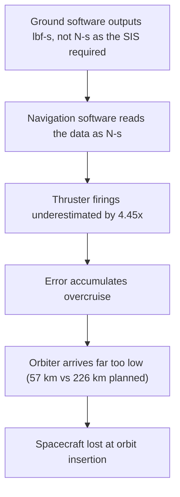

OB# Failure case analysis · <Mars Climate Orbiter> (v1.0, 2026-10-20)
Authors: Bou Socheat, Leng Choulita, Be Sovanntheavathana, Sron Lyfang, Sarim Sereyboth

## 1. Context

In December, 11, 1998. Nasa launch a robotic space probe "Mars Climate Orbiter" in partnership with Lockheed Martin Astronautics 
to study Mars' climate, atmosphere, and surface changes and to act as a communication relay equipments that was already on mars.
The software that control the thruster output had unit conversion errors causing the probe to descend too close the the planet and destroyed 
by its atmosphere.
This engineering disaster cost the organization $327.6 billion dollars in losses and it raised global awareness about the critical need
for strict unit standardization, rigorous software validation, and cross-organizational communication in complex engineering projects.

## 2. Timeline
| Date                            | Event                                                                                                                                               |
| December 11, 1998               | The Mars Climate Orbiter was launched.
| December 21, 1998               | Ground crews execute Trajectory Correction Maneuver 1 (TCM-1). The unit mismatch error begins introducing tiny, undetected navigation discrepancies.|
| March 4, 1999                   | TCM-2 is executed to further refine the path.|
| July 25, 1999                   | TCM-3 is executed. Navigators begin noticing slight drift discrepancies but cannot pinpoint the cause.|
| September 15, 1999              | TCM-4 is executed. This final maneuver locks the orbiter onto a collision course with the atmosphere due to the faulty software calculations.|
| September 23, 1999 02:01 AM PDT | The space craft begin its Mars Orbit Insertion.|
| September 23, 1999 02:10 AM PDT | The spacecraft dropped to an altitude of 57 km (35 miles) instead of the safe 140 km limit, causing atmospheric friction to break it apart.|
| September 24, 1999              | Reciving no signal NASA officially declares the Mars Climate Orbiter a total loss.|
 

## 3. What failed
The Mars Climate Orbiter was lost because of a units mismatch in its ground software. The Software Interface Specification required thruster impulse data in newton-seconds, but the file was produced in pound-force seconds, so the navigation software underestimated each thruster firing by a factor of 4.45. The firings were also far more frequent than the navigators expected, because the spacecraft’s solar array was asymmetrical, so the error added up during the cruise and the real trajectory ended up much lower than the estimated one. As a result, the spacecraft lost contact during orbit insertion on 23 September 1999 (NASA MIB, 1999, pp. 7, 13, 16).

## 4. Root causes
| # | Root cause | Type | Essential difficulty | Why |
|---|------------|------|----------------------|-----|
| R1 |           | technical / process / organisational | | |

## 5. Practices that would have prevented or limited it
| Root cause | Practice | Chapter |
|------------|----------|---------|

## 6. Lessons for ITC Club Hub
1.
2.

## 7. Sources
1. <author or organisation, title, year, URL> (primary)
