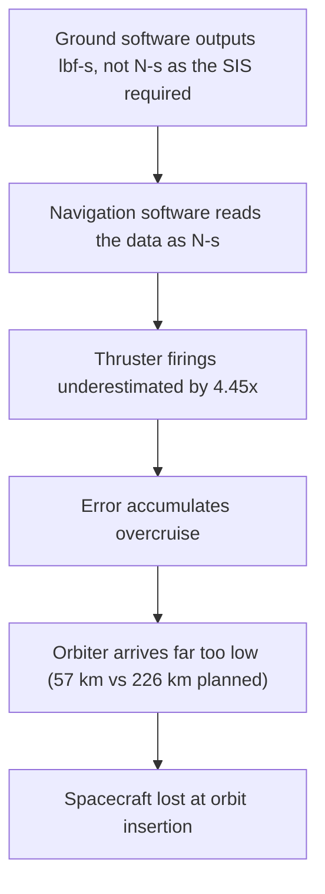

# Failure case analysis · <Mars Climate Orbiter> (v1.0, 2026-10-20)
Authors: Bou Socheat, Leng Choulita, Be Sovanntheavathana, Sron Lyfang, Sarim Sereyboth

## 1. Context

In December 11, 1998. NASA launched a robotic space probe "Mars Climate Orbiter" in partnership with Lockheed Martin Astronautics 
to study Mars' climate, atmosphere, and surface changes and to act as a communication relay to equipments that was already on mars.
The software that control the thruster output had unit conversion errors causing the probe to descend too close the the planet and was destroyed 
by its atmosphere.
This engineering disaster cost the organization $327.6 billion dollars in losses and it raised global awareness about the critical need
for strict unit standardization, rigorous software validation, and cross-organizational communication in complex engineering projects.

## 2. Timeline
| Date | Event |
| :--- | :--- |
| **December 11, 1998** | The Mars Climate Orbiter was launched. |
| **December 21, 1998** | Ground crews execute Trajectory Correction Maneuver 1 (TCM-1). The unit mismatch error begins introducing tiny, undetected navigation discrepancies. |
| **March 4, 1999** | TCM-2 is executed to further refine the path. |
| **July 25, 1999** | TCM-3 is executed. Navigators begin noticing slight drift discrepancies but cannot pinpoint the cause. |
| **September 15, 1999** | TCM-4 is executed. This final maneuver locks the orbiter onto a collision course with the atmosphere due to faulty software calculations. |
| **September 23, 1999** 02:01 AM PDT | The spacecraft begins its Mars Orbit Insertion. |
| **September 23, 1999** 02:10 AM PDT | The spacecraft dropped to an altitude of 57 km (35 miles) instead of the safe 140 km limit, causing atmospheric friction to break it apart. |
| **September 24, 1999** | Receiving no signal, NASA officially declares the Mars Climate Orbiter a total loss. |
 

## 3. What failed
The Mars Climate Orbiter was lost because of a units mismatch in its ground software. The Software Interface Specification required thruster impulse data in newton-seconds, but the file was produced in pound-force seconds, so the navigation software underestimated each thruster firing by a factor of 4.45. The firings were also far more frequent than the navigators expected, because the spacecraft’s solar array was asymmetrical, so the error added up during the cruise and the real trajectory ended up much lower than the estimated one. As a result, the spacecraft lost contact during orbit insertion on 23 September 1999 (NASA MIB, 1999, pp. 7, 13, 16).

## 4. Root causes
| # | Root cause             | Type                       | Essential difficulty                                 | Why                                                                       |              
|---|------------------------|----------------------------|------------------------------------------------------|---------------------------------------------------------------------------|
| R1| Technical root cause   | Unit mismatch/ Human error | ground software supplied by Lockheed Martin produced | The trajectory sofware calculation value expected in SI unit per Software |
|   |                        |                            | results in English unit instead of SI unit.          | interface Specification,causing calculation incorrect by a factor of 4.45.|
| R2| Orbital insertion      | Physical root cause        | The trajectory error sent the spacecraft down to an  | Because of the accumulated calculations errors the intense atmospheric and|                           
|   |                        |                            | altitude of 57 km instead of the targeted ~226 km.   | heat instanly destroy the orbiter.                                        | 
| R3| Organizational/Systemic| Process & Oversight Failure| The operations team ignored internal warning signs   | A "faster, better, cheaper" mission mindset led to inadequate systems     |
|   |                        |                            | from navigators and failed to conduct end-to-end     | engineering verification, poor communication between teams, and a lack of |
|   |                        |                            | Testing.                                             | formalized procedures to catch the unit mismatch                          |

## 5. Practices that would have prevented or limited it
| Root cause | Practice | Chapter |
|------------|----------|---------|

## 6. Lessons for ITC Club Hub Group 2
 1. Explicit Input and API Contract Validation (Preventing Unit Mismatches) Just as the Mars Climate Orbiter failed because ground software implicitly assumed metric units without validation, our ITC 
Club Hub Group 2's system must strictly enforce data validation boundaries at all integration checkpoints. Specifically, our CSV import and API payload parsers must explicitly reject any capacity values 
that are not whole numbers between 1 and 500, rather than relying on underlying database schemas or assumption-based type casting. Every external data source, user input, or system migration file must 
pass through an automated validator class that verifies both structural formats and application-specific constraints before it touches the core data layer.
 2. Comprehensive End-to-End Test Coverage for Third-Party or Legacy Code (Preventing Software Silos) The MCO disaster was worsened because the ground software's small forces calculations were never 
subjected to comprehensive end-to-end integration tests alongside the primary navigation software. For the ITC Club Hub, we cannot assume that existing utility scripts, third-party libraries, or legacy 
database population tools operate under the same logic as our current codebase. We must implement automated integration tests that simulate a complete user transaction lifecycle—from initial data 
seeding to final presentation—ensuring that data pipelines handling calculations (such as membership metrics or automated scheduling conflicts) are validated end-to-end rather than tested as isolated 
units.
 
## 7. Sources
1. <author or organisation, title, year, URL> (primary)
1. 
