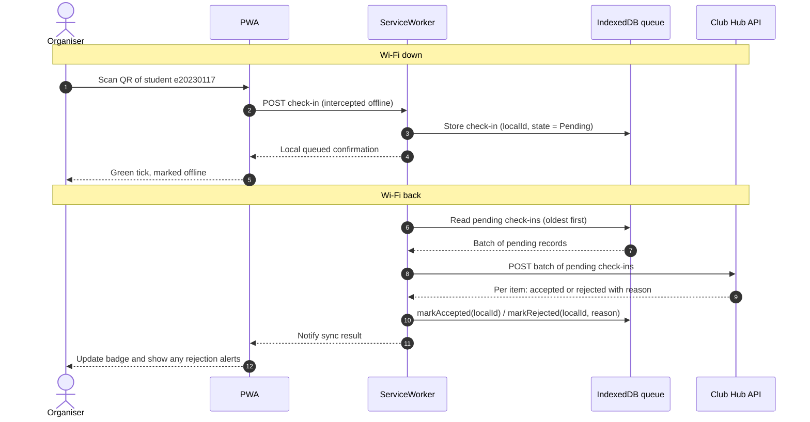

## 1. Sequence Diagram

## 2. Conflict Rules

| # | Case | Winner | Organiser sees | Stored on the server |
|---|---|---|---|---|
| 1 | Same student scanned at Door 1 and Door 2 | First scan request to reach the server | **Door 1:** Green tick (Accepted). **Door 2:** "Already checked in at another door" (Rejected). | The server accepts the first request and rejects subsequent requests for the same student and event as duplicates. |
| 2 | Registration cancelled on the server before the scan syncs | Server status (Cancelled) | Rejection alert after sync: "Registration cancelled on server." | Rejected with reason `"Registration cancelled"`. |
| 3 | Student not registered | Server validation (Denied) | Rejection alert after sync: "Student not registered." | Rejected with reason `"Student not registered"`. |
| 4 | Wi-Fi drops right after sending, so phone retries | First copy (`localId`) | Stays green (no change) | Server recognizes the unique `localId` it already processed and accepts it safely without duplicate. |
| 5 | Phone clock is 7 minutes wrong | Server clock | Green tick locally (pending sync). The server validates the timestamp during reconciliation. | Stored with the server ingestion time and, where appropriate, an adjusted timestamp within the event's permitted time bounds. |

## Idempotency and Device Clock Trust
Which field makes retried uploads idempotent (localId):
- The localId field in QueuedCheckIn (a UUIDv4 generated on the organiser's phone at the exact moment of the QR scan) makes retries idempotent (applied at most once).
- If the phone uploads a batch and loses connection before receiving the HTTP response, the ServiceWorker will retry sending the same batch. Because the server stores processed localId values in a unique constraint/set, it detects that the localId was already applied, skips inserting a duplicate row, and returns "Accepted" again.

Can we trust the device clock (scannedAt)?
- No, the client's scannedAt clock cannot be trusted as authoritative absolute time because an organiser's phone clock may be drifted, manually changed, or set to the wrong time zone.
- We only trust scannedAt for relative ordering of scans recorded on the same device (pending() uploads oldest first), while the server records its own authoritative syncedAt timestamp upon receipt and flags large discrepancies.
## Link to Quality Scenarios (QAS-01 to QAS-06)

 QAS-01 (Availability) — Improves significantly: The PWA no longer depends on continuous Wi-Fi at the door. Even if the network drops completely for several minutes during peak arrivals.
 QAS-02 (Performance at Check-In) — Improves significantly: Local writes to IndexedDB happen instantaneously (under 10 milliseconds), eliminating server round-trip latency and preventing long queues at the door.
 QAS-03 (Usability) — Makes harder / Introduces risk: While the door experience feels faster, organisers now need clear visual indicators (such as a badge showing pending vs. synced check-ins) so they know if a device is offline.
 QAS-04 (Security) — Makes harder: Storing attendance and student records locally in the browser's IndexedDB means sensitive personal data sits on organiser mobile devices. If a device is lost or stolen, data could be exposed, requiring encryption at rest or secure session tokens.
 QAS-05 (Modifiability) — Makes harder: The backend and API now need robust reconciliation logic to handle batch uploads, retries, and conflict resolution rather than simple synchronous writes.
 QAS-06 (Portability) — Neutral / Unaffected: As decided in ADR-001, the PWA approach remains cross-platform across mobile browsers, relying on standard browser storage APIs.

## New Quality Attribute Scenario: 5-Minute Network Outage

| Part	            | Content                         |
|-------------------|---------------------------------|
| Source	    | An organiser using the Club Hub PWA at the door of Amphi A |
| Stimulus	    | Complete Wi-Fi network outage occurs for 5 minutes during peak student arrival |
| Environment	    | Friday 17:55, 120 students arriving within 10 minutes |
| Artifact	    | ServiceWorker, IndexedDB queue, and CheckInQueue logic (include/clubhub/queued_checkin.hpp) |
| Response	    | Organiser scans QR codes continuously; local check-ins are stored in IndexedDB and display a green tick with an offline icon; when Wi-Fi recovers, the queue automatically syncs in the background |
| Response measure  | 0 dropped scans during the 5-minute outage; automatic background sync completes within 30 seconds of network recovery with 100% data integrity and zero manual intervention required from the organiser |

