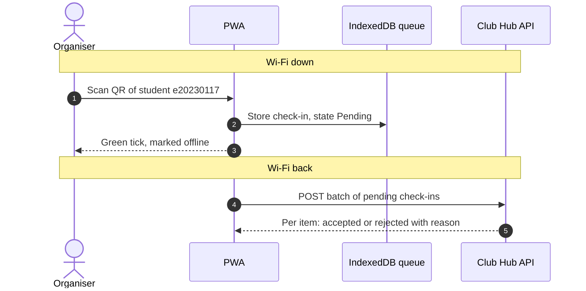

## 1. Sequence Diagram

## 2. Conflict Rules

| # | Case | Winner | Organiser sees | Stored on the server |
|---|---|---|---|---|
| 1 | Same student scanned at Door 1 and Door 2 | First scan request to reach the server | **Door 1:** Green tick (Accepted). **Door 2:** "Already checked in at another door" (Rejected). | The server accepts the first request and rejects subsequent requests for the same student and event as duplicates. |
| 2 | Registration cancelled on the server before the scan syncs | Server status (Cancelled) | Rejection alert after sync: "Registration cancelled on server." | Rejected with reason `"Registration cancelled"`. |
| 3 | Student not registered | Server validation (Denied) | Rejection alert after sync: "Student not registered." | Rejected with reason `"Student not registered"`. |
| 4 | Wi-Fi drops right after sending, so phone retries | First copy (`localId`) | Stays green (no change) | Server recognizes the unique `localId` it already processed and accepts it safely without making a duplicate. |
| 5 | Phone clock is 7 minutes wrong | Server clock | Green tick locally (pending sync). The server validates the timestamp during reconciliation. | Stored with the server ingestion time and, where appropriate, an adjusted timestamp within the event's permitted time bounds. |

