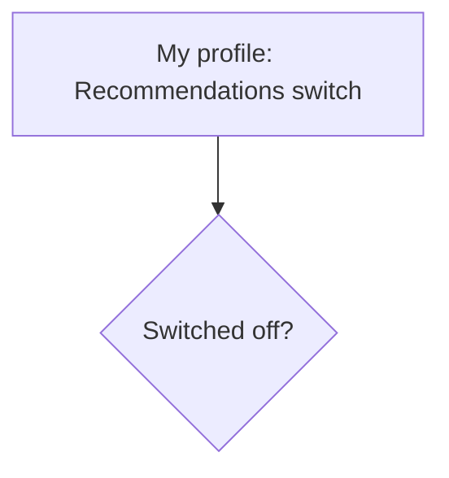

# AI feature proposal: "Recommended for you"
Version 0.1 · 2026-11-20 · Authors: Be Sovanntheavathana, Bou Socheat, Leng Choulita, Sron Lyfang, Sarim Sereyboth

## 1 Problem and non-personalised baseline

### User problem
As more student clubs publish workshops, competitions, and social meetups on **ITC Club Hub**, students face a crowded chronological list of upcoming events. Without filtering or prioritisation, students either miss relevant sessions hosted by clubs they have not joined yet or have to manually check individual club pages to find events matching their interests.

### Non-personalised baseline
Before building a personalised recommendation feature, a rule-based, non-personalised baseline can address much of this discovery problem without tracking individual attendance histories:
* **Events of my clubs (up to 3 slots):** Upcoming events from clubs in the student's active `clubMemberships` (`data/memberships.csv`), ordered chronologically by start date.
* **Popular this week (remaining slots, up to 5 total):** Upcoming events ranked by overall registration/RSVP volume across students over the past 7 days, excluding events the student has already registered for.

### What the baseline solves vs. what remains unsolved
* **Solved without personal profiling:** Surfaces active club events and campus-wide trending events using existing membership and aggregate registration counts rather than individual attendance tracking.
* **Remaining gap:** Does not surface relevant upcoming events from clubs outside the student's current memberships or infer topic preferences beyond explicit club joins.

---

## 2 Data needed

| Field | Source | In inventory? | New purpose / consent? | Minimisation |
|-------|--------|---------------|------------------------|--------------|
| `studentId` (pseudonymised / internal lookup only) | `data/students.csv` | Yes | **Yes** — currently used to identify students and block double registration; personalised recommendations require opt-in consent. | Never expose `name`, `email`, or `phone`; keep `studentId` masked in non-admin/non-self views and redact in logs. |
| `attendance` (individual check-ins / event history) | `data/registrations.csv` | Yes | **Yes** — currently used for room capacity planning and semester reports with individual check-ins purged at semester end; reuse for recommendations requires opt-in consent. | Restrict to a rolling **12-month** window (or current semester if semester-end purge is kept); do not use `name`, `email`, `phone`, `dateOfBirth`, or `photo`. |
| `clubMemberships` (active joined clubs) | `data/memberships.csv` | Yes | **Partial** — already powers *My clubs* and member-only event eligibility; using it in recommendation scoring is a secondary use covered by recommendation opt-in. | Read active memberships only; since memberships are deleted immediately when a student leaves a club, no stale membership history is retained. |
| Event & club catalog metadata (`eventId`, `clubId`, category/topic tags, event date, club member count) | Event & club catalog tables | Partial (catalog/club metadata outside student PII table) | **No** — public event and club listing metadata used to display and organise events. | Use structured category/topic tags and club size only; exclude free-text notes and keep personal contact details out. |
| `derivedInterestProfile` (category affinity weights per opted-in user) | Recommendation scoring process (new) | **No** (new derived data) | **Yes** — new personal preference profile created solely for "Recommended for you"; requires explicit opt-in. | Store only minimal category/club affinity weights; delete within **24 hours** when the student switches recommendations off. |

### Task 1 decisions that would change
If "Recommended for you" is approved, the following decisions in `data-inventory.md` (Version 2.0) would need to be updated
1. **`attendance` retention and aggregation rule:** Currently, individual check-ins in `data/registrations.csv` are purged at semester end and only club totals are kept for room capacity and semester reports. Supporting a 12-month attendance window for opted-in recommendations would require revising that retention/purge rule or limiting history to the active semester.
2. **Inventory & purpose scope:** Add `derivedInterestProfile` to the data inventory and record "Recommended for you" as an optional, opt-in purpose for `studentId`, `clubMemberships`, and eligible `attendance` data
3. **Deletion & log handling:** Add a deletion rule removing `derivedInterestProfile` within 24 hours of opting out, and ensure recommendation evaluation/debug logs follow the `redacted()` rule with no `name`, `email`, or `phone`

---

## 3 Bias risks

| Risk | Who is harmed | Mitigation | Fairness check (metric, threshold) |
|------|---------------|------------|------------------------------------|
| **1. Cold-start bias (no attendance or membership history)** | New students, first-year students, and students with no recorded check-ins receive blank, sparse, or irrelevant suggestions. | Fall back to the non-personalised baseline (`Events of my clubs` + `Popular this week`) when a student has no attendance history or few data points. | **Coverage & click parity:** 100% of opted-in zero-history users receive 5 valid upcoming events, and their click-through rate (CTR) is at least **75%** of returning users' CTR. |
| **2. Popularity feedback loop** | Smaller, newer, or niche clubs and less-hyped events get fewer views/RSVPs because high-RSVP events keep getting promoted. | Reserve **at least 2 of the 5 slots** for clubs the student has never attended and dampen raw RSVP popularity counts in ranking. | **Unvisited-club slot share:** At least **40%** (2 of 5 slots on average) of recommended items come from clubs the student has not previously attended. |
| **3. Attendance as a proxy for time, money, distance, or accessibility** | Students with part-time jobs, longer commutes, financial constraints, or accessibility needs who attend fewer events risk being treated as low-interest or getting poorer recommendations. | Do not penalise low attendance counts; surface accessible, free, and on-campus events fairly rather than assuming low attendance means disinterest. | **Low-activity group parity:** Opted-in students with 1–2 check-ins receive 5 valid recommendations (100% fill rate) with an RSVP/save rate within **20 percentage points** of more frequent attendees. |
| **4. Large clubs crowding out small clubs** | Small clubs (fewer than 20 members) are overshadowed by large clubs that run frequent or high-headcount events. | Limit recommendations to **at most 1 event per club** in a 5-item list and apply club-size balancing during ranking. | **Small-club exposure check:** Monthly check showing clubs with **fewer than 20 members** receive **at least 80% of their fair share** of recommendations relative to their share of events. |

## 4 Transparency
"Why am I seeing this?" example: TODO
## 5 Opt-out design

## 6 Recommendation
Decision: GO / NO-GO / GO WITH CONDITIONS
Conditions: TODO · Owner of the fairness check: TODO