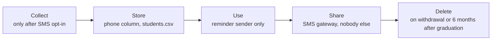

# Data inventory · ITC Club Hub
Version 0.2 · 2026-11-16 · Authors: Bou Socheat, Be Sovanntheavathana, Leng Choulita, Sron Lyfang, Sarim Sereyboth

| Field | Subject | Purpose | Legal basis / consent | Retention | Who can see it | Stored in | Decision |
|---|---|---|---|---|---|---|---|
| studentId | student | identify; block double registration | Necessary for the service | Until account deleted | Administrator | data/students.csv | Mask for organisers: Security reason |
| name | student | Identify the list of participant | Necessary for the service | Until account deleted | Event organizers and user | data/event.csv | Mask for non-participant and organizer: Privacy reason |
| email | student | Send event registration confirmations and cancellation notices | Necessary for the service: required to deliver booking receipts | Until account deleted | Student (own), administrator | data/students.csv | Keep: primary reliable channel for transactional event confirmations. |
| phone | student | SMS reminder 24 h before an event, only if chosen | Consent (opt-in), withdrawable in *My profile* | Deleted at once on withdrawal, otherwise 6 months after graduation | Nobody on screen; read only by the reminder sender | data/students.csv | Keep optional: SMS reaches students without mobile data, while core booking works without it. |
| clubMemberships | student | Show joined clubs on *My clubs* and restrict members-only events | Necessary for the service: enforces club access rules | Kept while membership is active; deleted immediately upon leaving club | Student (own), respective club leader, administrator | data/memberships.csv | Keep: directly powers club rosters and member-only event eligibility. |
| attendance | student | Track event check-ins for room capacity planning and semester reports | Legitimate interest: clubs need turnout totals to request rooms and budgets | Individual check-ins purged at semester end; only club totals kept | Club leader (aggregated count only), administrator | data/registrations.csv | Aggregate: club leaders only need total headcount per event, not individual histories. |
| dateOfBirth | student | None: no feature, rule or report uses it | None | Not Collected | Nobody | Not Stored|Drop: "might be useful" is not a valid purpose. |
| facultyAndYear | student | Tailor academic workshop announcements and report department interest | Consent (opt-in) in *My profile*, clearable anytime | Until account deleted or cleared by student | Student (own), club leader (aggregated stats only), administrator | data/students.csv | Keep optional: helps academic clubs gauge department interest without blocking registration. |
| photo | student | None: physical student ID card check at the door already verifies identity | None | Not collected | Nobody | Not stored | Drop: storing portraits creates unnecessary biometric privacy risk for zero functional gain. |

## Copies of personal data
| Copy | Rule |
|---|---|
| log files | only `redacted()` output, never name, email or phone |
| CSV exports | Strip `phone` and `email` by default; mask `studentId` for organisers; delete temporary exports within 24 hours. |
| test fixtures | Use synthetic dummy records only (e.g., `e20260001`, `Test Student`, `test@example.edu`); never copy real student CSVs into `tests/`. |
| backups | Encrypt backups at rest, restrict access to administrators, and purge deleted accounts within 30 days. |
| screenshots in docs | Use synthetic test accounts or blur all names, IDs, emails, and phone numbers before committing images. |

## Lifecycle of the phone field

## Client feedback
- TA walkthrough completed: reviewed Drop decisions (dateOfBirth, photo), Mask rules (studentId, name), and Aggregate rule (attendance). No client objections raised.
